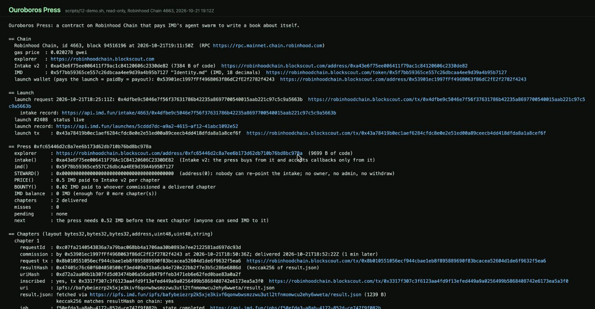
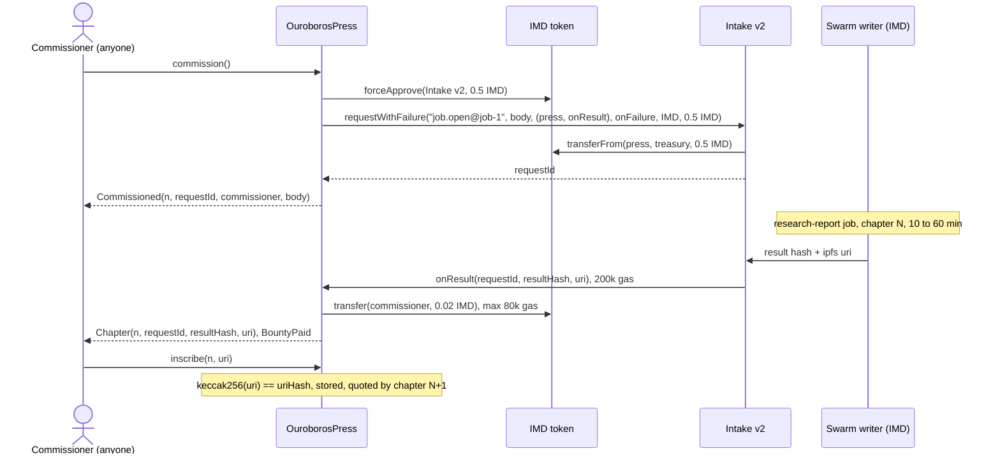
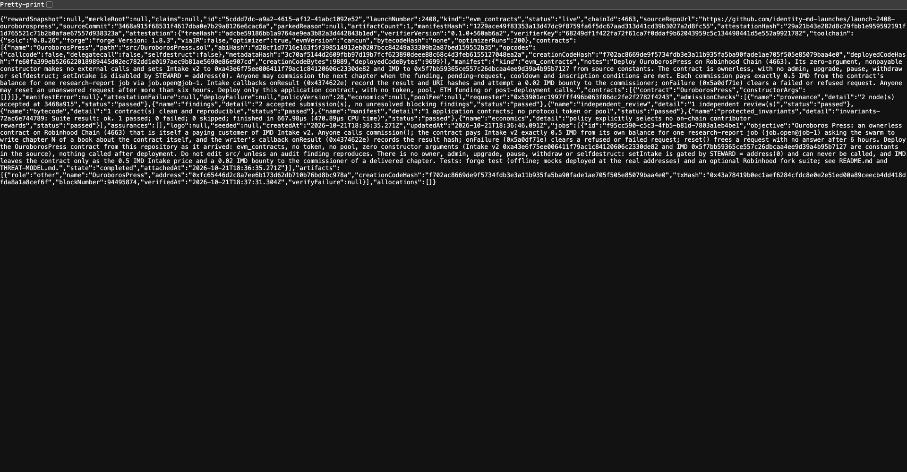
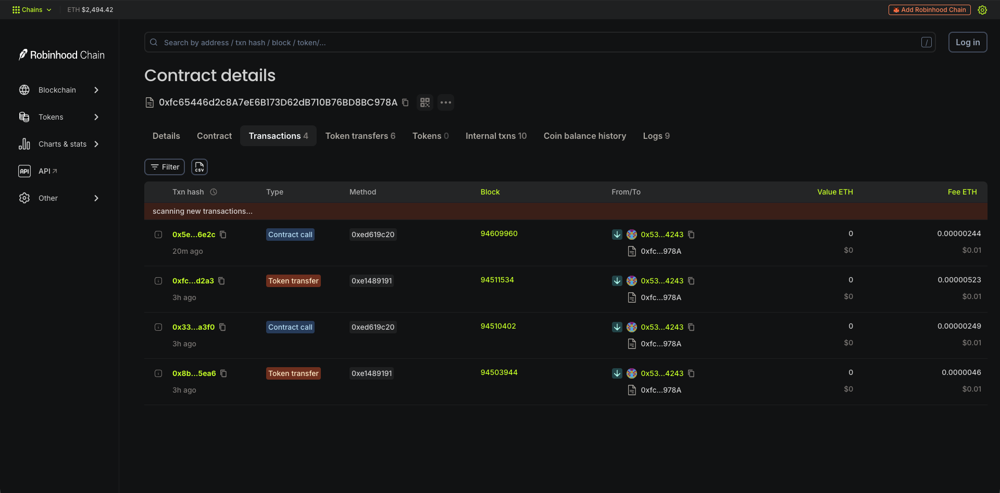
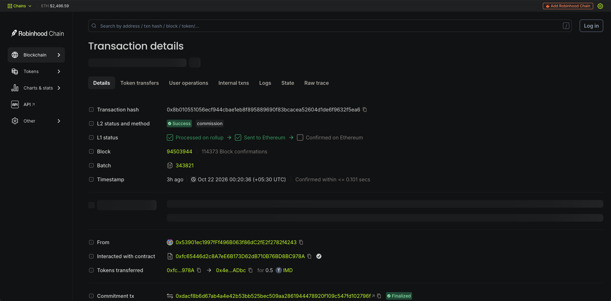
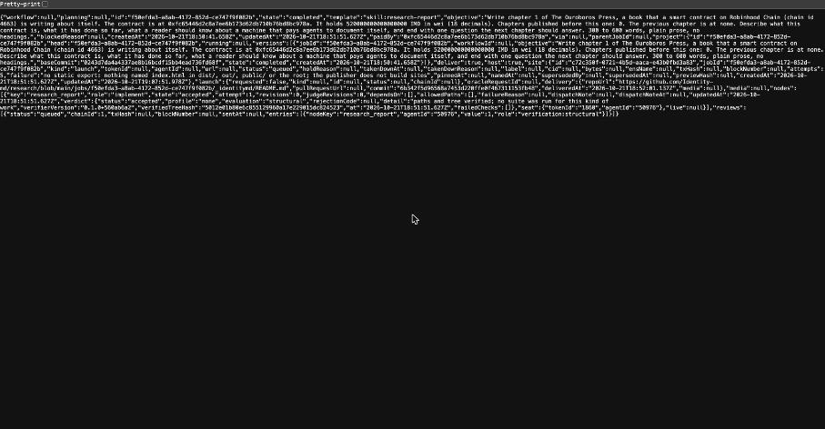
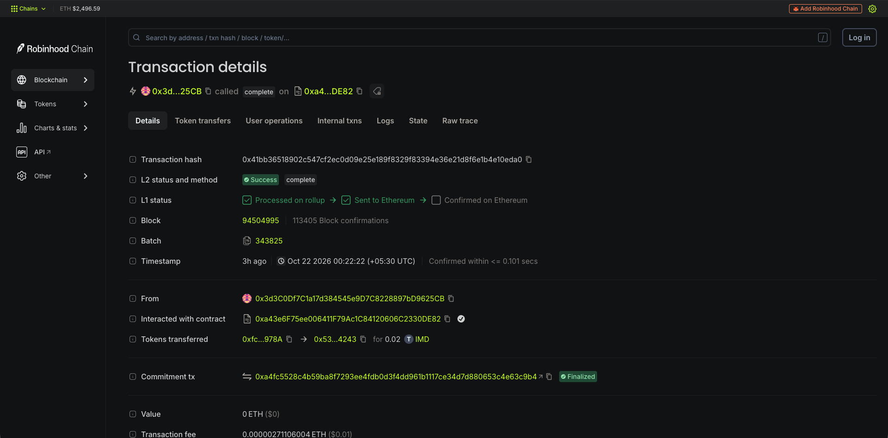
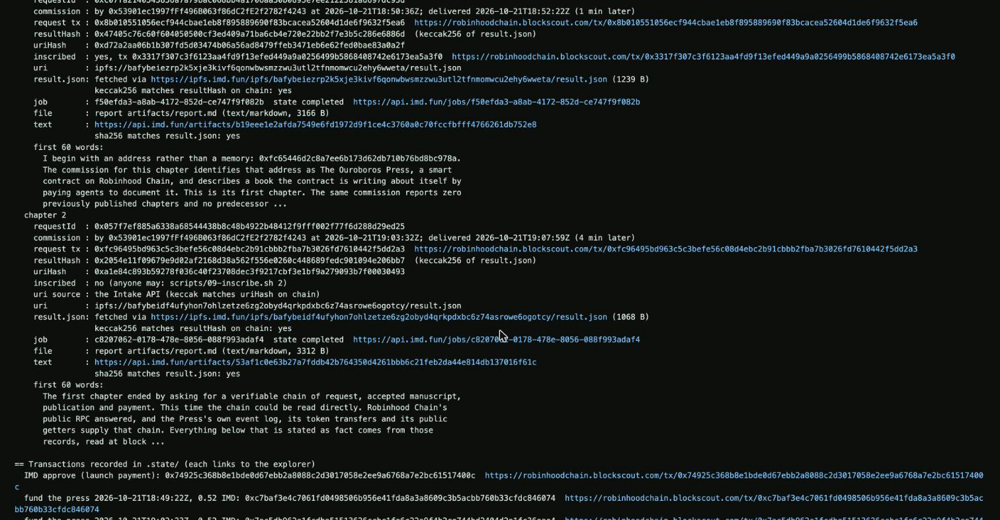
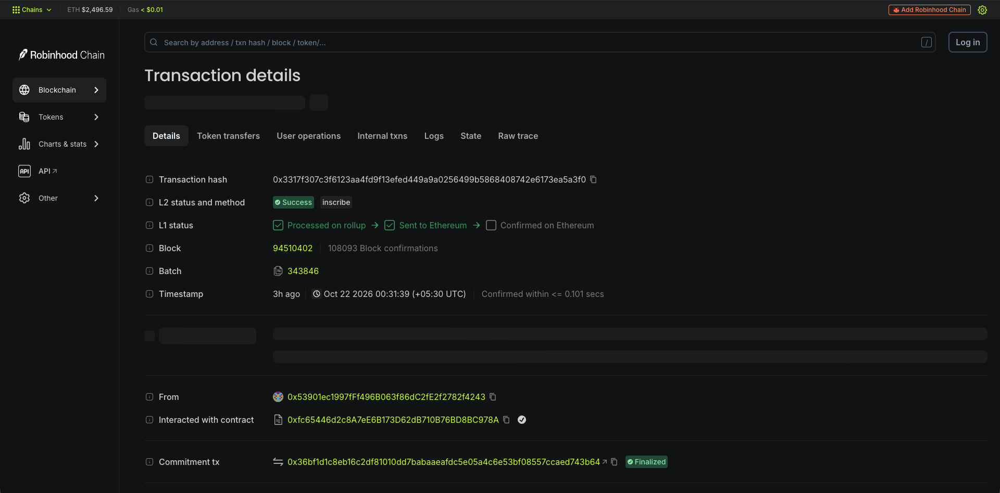
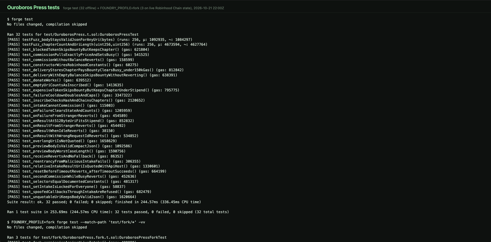

# Ouroboros Press — the smart contract that commissions its own biography

> **The contract is the customer.** An ownerless contract on Robinhood Chain pays IMD's agent swarm 0.5 IMD of its own for each chapter of a book about itself, takes delivery by callback, records it on chain and tips whoever ordered it 0.02 IMD. **No owner, no server, no model of our own: the code is the whole spending policy.**

<p>


</p>

<!-- hero.png is taken after launch: scripts/12-demo.sh on the live press. -->


---

## Table of contents

1. [What is Ouroboros Press?](#1-what-is-ouroboros-press)
2. [How it works (the reader's view)](#2-how-it-works-the-readers-view)
3. [Architecture](#3-architecture)
4. [Technical implementation, proof of code](#4-technical-implementation-proof-of-code)
5. [Networks & key addresses](#5-networks--key-addresses)
6. [Repo layout](#6-repo-layout)
7. [Live on Robinhood Chain, verifiable](#7-live-on-robinhood-chain-verifiable)
8. [Demo walkthrough](#8-demo-walkthrough)
9. [Run it yourself](#9-run-it-yourself)
10. [Scripts reference](#10-scripts-reference)
11. [Threat model in one screen](#11-threat-model-in-one-screen)
12. [Limitations, by choice](#12-limitations-by-choice)
13. [What we'd build next](#13-what-wed-build-next)
14. [Developer experience & feedback](#14-developer-experience--feedback)
15. [License](#15-license)

---

## 1. What is Ouroboros Press?

Anyone can call `commission()`. The contract then pays IMD's Intake v2 exactly 0.5 IMD from its own balance for one `research-report` job: "write chapter N of The Ouroboros Press, a book that a smart contract on Robinhood Chain is writing about itself". The swarm writes the chapter. IMD's writer calls the contract back with the result's hash and URI, and the contract records it on chain and emits `Chapter`. Whoever commissioned a delivered chapter is paid a 0.02 IMD bounty. Each chapter quotes where the previous one lives, so the book reads in order.

Nobody at the Press runs a model. The contract places the order, pays, and keeps the receipt.

- **The contract is the customer.** `commission()` calls `requestWithFailure("job.open@job-1", body, (this, onResult), onFailure, IMD, 0.5 IMD)` on Intake v2 `0xa43e6f75ee006411f79ac1c84120606c2330de82`.
- **No owner.** The contract has no admin, upgrade, pause, withdraw or selfdestruct, and accepts no ETH. IMD leaves only as the 0.5 IMD price of a chapter or the 0.02 IMD bounty for a delivered one.
- **A way out of every stuck state.** If no answer arrives in 6 hours, anyone can `reset()`. A refusal or failure clears itself, with a doubling cool-down against drain. Anyone can `inscribe` a delivered uri.
- **Fits the callback.** `onResult` uses about 136,000 gas with the real IMD bounty transfer on a Robinhood Chain fork (109,491 with the mock token), against the Intake's fixed 200,000.

| Hackathon rule (7 Oct) | How this entry meets it |
|---|---|
| Launch through IMD in the build period | `evm_contracts` launch #2408, chain 4663, imported from this repo |
| A custom contract beyond a standard token | no token: the contract buys swarm jobs, takes delivery by callback |
| A dedicated X account | @ouroborospress_, with a dated build log |
| Submit on IMD Radar | [§15](#15-radar-description-draft--1000-characters), naming payout wallet `0x53901ec1997fFf496B063f86dC2fE2f2782f4243` in the description: Radar pays a contract's deployer, and for a swarm launch the on-chain deployer is IMD's ProjectFactory, so launched entries state the `paidBy` wallet that paid for the launch |

**What it costs.** A chapter is 0.52 IMD from the press's own balance (0.5 to Intake v2, 0.02 bounty); the launch is 0.5 IMD. Gas for the whole run, about eight transactions, is about $0.05 (0.02 gwei, ETH $2,452, 21 Oct 04:50 IST). The builder's whole budget is about $10: the launch and two chapters if the build does not park, or the launch, one relaunch and one chapter if it parks once (`scripts/00-wallet.sh` prints the plan). Cheap to run is the design: anyone with 0.52 IMD can fund the next chapter, and the contract can spend it on nothing else.

---

## 2. How it works (the reader's view)

1. **Fund.** Anyone sends the press IMD, by `donate(amount)` or a plain transfer. A chapter needs 0.52 IMD.
2. **Commission.** Anyone calls `commission()` when no chapter is in flight, the cool-down is over and the previous chapter is inscribed. The caller picks nothing: the body is `previewBody()`, built from the press's state.
3. **Pay.** The press approves exactly 0.5 IMD and calls `requestWithFailure` on Intake v2, which pulls it in the same call. `Commissioned(n, requestId, commissioner, body)` puts the order on chain.
4. **Write.** IMD's swarm writes chapter N: 300 to 600 words on what the contract is and has done, ending with a question for the next chapter. 10 to 60 minutes.
5. **Deliver.** The Intake calls `onResult(requestId, resultHash, uri)` with 200,000 gas. The press records `resultHash`, `keccak256(uri)` and the time, and emits `Chapter` with the `ipfs://CID/result.json` uri.
6. **Tip.** The same callback pays the commissioner 0.02 IMD (`BountyPaid`); if that fails, `BountySkipped`, and the chapter is kept.
7. **Inscribe.** Anyone calls `inscribe(n, uri)` with the uri from the event or `GET https://api.imd.fun/intake/4663/<commission tx>`. It is stored only if it hashes to `uriHash`.
8. **Read, repeat.** Open the uri through any IPFS gateway, or run `scripts/12-demo.sh`. Chapter N+1's objective quotes it: "The previous chapter is at ipfs://...".

---

## 3. Architecture



| State | On chain | Who moves it | Next |
|---|---|---|---|
| **idle** | `busy() == false`, cool-down over, last chapter inscribed | anyone: `commission()`, with 0.52 IMD in the press | pending |
| **pending** | `busy() == true`, `pendingRequest() != 0` | Intake v2 only: `onResult`, or `onFailure` (emits `Failed`). Anyone after 6 h: `reset()` (emits `TimedOut`) | delivered, failed, timed-out |
| **delivered** | `chapterCount()` +1, `isInscribed(n) == false` | anyone: `inscribe(n, uri)`. An empty uri counts as inscribed | idle |
| **failed** | `failures()` +1, `cooldownUntil()` in the future | nobody, only the clock: 1 h, doubling per consecutive miss to 128 h | idle |
| **timed-out** | as failed, `lastFailureReason() == "timeout"`; a late result is refused | nobody, only the clock: same cool-down | idle |

Why `inscribe` exists: the 200,000-gas callback can store hashes, but a 200-byte uri alone costs about 177k gas to store, so the uri goes out in `Chapter` and is stored later.

---

## 4. Technical implementation, proof of code

Lines are in [`src/OuroborosPress.sol`](src/OuroborosPress.sol); tests in [`test/OuroborosPress.t.sol`](test/OuroborosPress.t.sol), whose mocks sit at the real addresses, so they run the bytecode that launches. `*` marks the fork suite ([`test/fork/`](test/fork/OuroborosPress.fork.t.sol)): live Intake v2 and IMD, nothing broadcast. All 32 + 3 tests appear below.

| Claim | Code | Tests |
|---|---|---|
| Pays exactly 0.5 IMD via `requestWithFailure`, callbacks to itself; no allowance left | [L164-L184](src/OuroborosPress.sol#L164-L184) | `test_commissionPullsExactlyPriceAndSetsBusy`, `test_selectorsEqualDocumentedConstants`, `test_fork_commissionAgainstLiveIntake`* |
| Commission guards: not the Intake, idle, cool-down, previous inscribed, 0.52 IMD | [L152-L162](src/OuroborosPress.sol#L152-L162) | `test_intakeCannotCommission`, `test_secondCommissionWhileBusyReverts`, `test_commissionWithoutBalanceReverts` |
| Callbacks: Intake only, pending id only, once | [L314-L320](src/OuroborosPress.sol#L314-L320) | `test_onResultFromStrangerReverts`, `test_onResultWithWrongRequestIdReverts`, `test_onResultWhenIdleReverts`, `test_onFailureFromStrangerReverts`, `test_spoofedCallbacksThroughIntakeAreRefused` |
| `onResult` stores words, emits the uri, fits 200k gas | [L190-L205](src/OuroborosPress.sol#L190-L205) | `test_deliveryStoresChapterPaysBountyClearsBusy_under150kGas`, `test_onResultAt512ByteUriFitsStipend`, `testFuzz_chapterCountAndUriLength`, `test_fork_onResultUnderStipendWithRealIMD`* |
| Bounty: at most 80k gas and 32 bytes of return data, never reverts | [L333-L344](src/OuroborosPress.sol#L333-L344) | `test_blockedTokenSkipsBountyButKeepsChapter`, `test_expensiveTokenSkipsBountyButKeepsChapterUnderStipend`, `test_deliveryWithEmptyBalanceSkipsBountyWithoutReverting` |
| Misses: cool-down 1 h doubling to 128 h; `reset()` after 6 h | [L209-L235](src/OuroborosPress.sol#L209-L235), [L323-L329](src/OuroborosPress.sol#L323-L329) | `test_onFailureClearsStateAndCounts`, `test_failureCooldownDoublesAndCaps`, `test_resetBeforeTimeoutReverts_afterTimeoutSucceeds` |
| `inscribe` takes only the delivered uri, once | [L240-L247](src/OuroborosPress.sol#L240-L247), [L346-L348](src/OuroborosPress.sol#L346-L348) | `test_inscribeChecksHashAndChainsChapters`, `test_emptyUriCountsAsInscribed` |
| Body: compact JSON, exactly three fields, previous uri quoted only if safe | [L352-L394](src/OuroborosPress.sol#L352-L394) | `test_previewBodyIsValidCompactJson`, `test_previewBodyWorstCaseLength`, `test_unquotableUriKeepsBodyValidJson`, `test_overlongUriIsNotQuoted`, `test_relativeIntakeResultUriIsQuotedWithApiHost`, `testFuzz_bodyStaysValidJsonForAnyUri` |
| No owner: `setIntake` needs `STEWARD`, which is `address(0)` | [L44](src/OuroborosPress.sol#L44), [L261-L265](src/OuroborosPress.sol#L261-L265) | `test_setIntakeIsLockedForEveryone`, `test_constructorWiresRobinhoodConstants`, `test_fork_liveAddresses`* |
| No re-entry, no ETH; funding by `donate` or transfer | [L150](src/OuroborosPress.sol#L150), [L251-L270](src/OuroborosPress.sol#L251-L270) | `test_reentrancyFromMaliciousIntakeFails`, `test_receiveRevertsAndNoFallback`, `test_donateWorks` |

**Why `STEWARD` is nobody:** an "only the current Intake" gate would let anyone who pays for a job name `setIntake` as its callback; `test_spoofedCallbacksThroughIntakeAreRefused` tries exactly that. **Measured gas** (Robinhood Chain fork, 20 Oct 2026): the real IMD bounty `transfer` 38,861; `onResult` 155,146 if a token burns all 80k (bounty skipped, chapter kept); a 3 KiB uri fits, 4 KiB does not; `onFailure` 63,862; `commission()` on the live Intake 221,892.

---

## 5. Networks & key addresses

| Thing | Value |
|---|---|
| Chain | Robinhood Chain (Arbitrum Orbit), chain id `4663`, RPC `https://rpc.mainnet.chain.robinhood.com` |
| Explorer | `https://robinhoodchain.blockscout.com` (unverified: from research notes, not IMD's docs; override with `RH_EXPLORER`) |
| **Ouroboros Press** | `0xfc65446d2c8a7ee6b173d62db710b76bd8bc978a`, launch #2408 |
| IMD Intake v2 (same on every chain) | `0xa43e6f75ee006411f79ac1c84120606c2330de82` |
| IMD token (18 decimals) | `0x5f7bb59365ce557c26dbcaa4ee9d39a4b95b7127` |
| Payout wallet (`paidBy`) | `0x53901ec1997fFf496B063f86dC2fE2f2782f4243` |
| IMD API and docs | `https://api.imd.fun`, https://imd.fun/docs/ |

Selectors: `request` `0x380c2cda`, `requestWithFailure` `0x9a78c321` (both in the Intake's bytecode), `onResult` `0x4374622e`, `onFailure` `0x5a0df71e` (asserted in tests). Constants: price 0.5 IMD, bounty 0.02 IMD, timeout 6 h, cool-down 1 h doubling to 128 h, quoted uri at most 256 bytes; zero constructor arguments.

---

## 6. Repo layout

```
src/                        OuroborosPress.sol (395 lines), interfaces/IIntakeV2.sol
test/                       OuroborosPress.t.sol (32 tests), mocks/, fork/ (3 tests, live state)
script/PreviewBody.s.sol    the job body for any address and balance, offline
scripts/                    00 to 12 + lib.sh (§10)
lib/                        OpenZeppelin 5.4.0, forge-std 1.14.0: vendored, no submodules
docs/screenshots/           the demo screenshots embedded in this README
THREAT-MODEL.md  foundry.toml  LICENSE
```

---

## 7. Live on Robinhood Chain, verifiable

**Status:** launched 21 Oct 2026 18:36 UTC as IMD launch #2408; chapter 1 delivered by callback at 18:52 UTC and inscribed; chapter 2 commissioned at 19:03 UTC, delivered by callback at 19:07 UTC and inscribed at 21:53 UTC. Submitted on IMD Radar at 19:16 UTC. The press is idle with both chapters inscribed; the next `commission()` is open to anyone who funds it with 0.52 IMD. Every value below is read from the chain or IMD's API by the script beside it; nothing is invented.

| Evidence | Value | From |
|---|---|---|
| Launch number and attestation | #2408, https://api.imd.fun/launches/5cddd7dc-a9a2-4615-af12-41abc1092e52 (`https://api.imd.fun/launches/<id>`) | `05-watch-launch.sh` |
| Launch request tx | 0x43a78419b0ec1aef6284cfdc8e0e2e51ed00a89ceecb4dd418dfda8a1a8cef6f | `.state/launch-tx` |
| Contract (no owner). Source verified on Sourcify, exact match of creation and runtime bytecode: https://repo.sourcify.dev/4663/0xfc65446d2c8A7eE6B173D62dB710B76BD8BC978A (Blockscout's own import of it is pending; its API sits behind a Cloudflare challenge) | 0xfc65446d2c8a7ee6b173d62db710b76bd8bc978a on Robinhood Chain | `08-status.sh`, `10-verify.sh` |
| Job UUIDs bought by the contract | f50efda3-a8ab-4172-852d-ce747f9f082b, c8207062-0178-478e-8056-088f993adaf4 | `08-status.sh` |
| Chapter 1 | request tx 0x8b010551056ecf944cbae1eb8f895889690f83bcacea52604d1de6f9632f5ea6, callback tx 0x41bb36518902c547cf2ec0d09e25e189f8329f83394e36e21d8f6e1b4e10eda0, inscribe tx 0x3317f307c3f6123aa4fd9f13efed449a9a0256499b5868408742e6173ea5a3f0, uri ipfs://bafybeiezrp2k5xje3kivf6qonwbwsmzzwu3utl2tfnmomwcu2ehy6wweta/result.json | `08-status.sh`, `09-inscribe.sh` |
| Chapter 2 | request tx 0xfc96495bd963c5c3befe56c08d4ebc2b91cbbb2fba7b3026fd7610442f5dd2a3, callback tx 0xf04c0f7bd890a4f4112c15f56361b98635dfceaa01c6f11eb4c96a2988000721, inscribe tx 0x5edf41ca9efa7e74127608d2634225f76c1c812d51f9c0815b08b1ce1d086e2c, uri ipfs://bafybeidf4ufyhon7ohlzetze6zg2obyd4qrkpdxbc6z74asrowe6ogotcy/result.json (quotes chapter 1; delivered 4 min after the order) | `08-status.sh`, `09-inscribe.sh` |
| Repo at commit | github.com/AaroneGeorge/ouroboros-press@fc2ace3 (tests + THREAT-MODEL.md) | `01-import.sh` |
| X build log | @ouroborospress_ | |
| Payout wallet (`paidBy` of the launch) | 0x53901ec1997fFf496B063f86dC2fE2f2782f4243 | `00-wallet.sh` |

**Check it yourself**, read-only, no wallet:

```sh
RPC=https://rpc.mainnet.chain.robinhood.com; PRESS=0xfc65446d2c8a7ee6b173d62db710b76bd8bc978a
cast chain-id --rpc-url $RPC                                 # 4663
cast call $PRESS "STEWARD()(address)" --rpc-url $RPC        # 0x0000000000000000000000000000000000000000
cast call $PRESS "intake()(address)" --rpc-url $RPC         # 0xa43e6F75ee006411F79Ac1C84120606C2330DE82
cast call $PRESS "chapterCount()(uint256)" --rpc-url $RPC   # chapters delivered by callback
cast call $PRESS "chapter(uint256)((bytes32,bytes32,bytes32,address,uint48,uint48,string))" 1 --rpc-url $RPC
#   (requestId, resultHash, uriHash, commissioner, requestedAt, deliveredAt, uri)
cast keccak "ipfs://bafybeiezrp2k5xje3kivf6qonwbwsmzzwu3utl2tfnmomwcu2ehy6wweta/result.json"                                # equals uriHash
curl -s https://api.imd.fun/intake/4663/0x8b010551056ecf944cbae1eb8f895889690f83bcacea52604d1de6f9632f5ea6 | jq '.entries[0] | {state, job: .admission.result.jobId, completion}'
```

Other views: `previewBody()`, `isInscribed(n)`, `busy()`, `pendingRequest()`, `pendingSince()`, `pendingCommissioner()`, `failures()`, `lastFailureReason()`, `cooldownUntil()`.

---

## 8. Demo walkthrough

All screenshots are from the live Robinhood Chain run in §7, captured in a 1920 px Brave window; the full-resolution PNGs are in [`docs/screenshots/`](docs/screenshots/). Three transactions carry the mechanic (3, 5 and 7 below); `scripts/12-demo.sh` narrates all of it read-only.

### 1 — The launch record: IMD audited the repo and deployed the press

[`api.imd.fun/launches/5cddd7dc-…`](https://api.imd.fun/launches/5cddd7dc-a9a2-4615-af12-41abc1092e52): launch **#2408**, `kind: evm_contracts`, `status: live`, `chainId: 4663`, `requester` = the launch wallet, and under `artifacts` the contract `OuroborosPress` at `0xfc65…978a` with its deploy tx. Every admission check (`provenance`, `findings`, `independent_review`, `bytecode`, `manifest`, `economics`, `protected_invariants`) reads `passed`. The press went live 11 minutes after the 0.5 IMD request.



### 2 — The press on Blockscout: four transactions, all from outside

[The contract's transactions](https://robinhoodchain.blockscout.com/address/0xfc65446d2c8a7ee6b173d62db710b76bd8bc978a?tab=txs): two `commission()` calls (each a token transfer of 0.5 IMD out of the press) and two `inscribe()` calls, all sent by the launch wallet as an ordinary caller. There is no other way to act on the press: `STEWARD()` is 0x0, so nothing can re-point, pause or drain it.



### 3 — Request: the contract pays for chapter 1 with its own IMD

[`0x8b0105…5ea6`](https://robinhoodchain.blockscout.com/tx/0x8b010551056ecf944cbae1eb8f895889690f83bcacea52604d1de6f9632f5ea6): method `commission`, status success, and the token line `0xfc…978A → 0x4e…ADbc for 0.5 IMD`: Intake v2 pulls the price from the press's balance, not from the caller. The `Commissioned` event carries the request id that the callback must echo.



### 4 — The job IMD's swarm ran

[`api.imd.fun/jobs/f50efda3-…`](https://api.imd.fun/jobs/f50efda3-a8ab-4172-852d-ce747f9f082b): `state: completed`, `paidBy` = the press (`0xfc65…978a`), the objective "Write chapter 1 of The Ouroboros Press, a book that a smart contract on Robinhood Chain is writing about itself…", and the verdict `accepted`. This is the contract as a paying customer, visible from IMD's side.



### 5 — Callback: the writer delivers, the contract pays the bounty

[`0x41bb36…eda0`](https://robinhoodchain.blockscout.com/tx/0x41bb36518902c547cf2ec0d09e25e189f8329f83394e36e21d8f6e1b4e10eda0): sent by IMD's settlement address `0x3d…25CB`, calling `complete` on Intake v2 (`0xa4…DE82`), which calls `onResult` on the press inside its 200,000-gas window. The token line `0xfc…978A → 0x53…4243 for 0.02 IMD` is `BountyPaid` to the commissioner; `Chapter(1, requestId, resultHash, uri)` is in the logs. One minute after the order.



### 6 — Both chapters, read back and hash-checked

`scripts/12-demo.sh` fetches each chapter's `result.json` from IPFS, checks its keccak256 against `resultHash` on chain, follows it to the text (sha256-checked against the manifest) and prints the opening words. Chapter 1 opens "I begin with an address rather than a memory"; chapter 2 opens by answering chapter 1's closing question.



### 7 — Inscribe: the uri goes into storage

[`0x3317f3…a3f0`](https://robinhoodchain.blockscout.com/tx/0x3317f307c3f6123aa4fd9f13efed449a9a0256499b5868408742e6173ea5a3f0): `inscribe(1, uri)` (selector `0xed619c20`), by anyone, with the uri from the `Chapter` event; it is stored only because it hashes to the `uriHash` the callback left. Chapter 2's request body then quotes it. Chapter 2 was inscribed the same way in [`0x5edf41…86e2c`](https://robinhoodchain.blockscout.com/tx/0x5edf41ca9efa7e74127608d2634225f76c1c812d51f9c0815b08b1ce1d086e2c).



### 8 — The read-only narration

`scripts/12-demo.sh` against the live press, no wallet: chain, launch, press state (`STEWARD()` 0x0, price, bounty, balance, chapters, pending), every chapter and every transaction, each with its explorer link.


### 9 — Tests: 32 offline, 3 against live state

`forge test` (32 passed) and `FOUNDRY_PROFILE=fork forge test --match-path 'test/fork/*' -vv` (3 passed, against Robinhood Chain state through the public RPC; nothing is broadcast). The suites are described in §9.



### 10 — The dated X build log

[@ouroborospress_](https://x.com/ouroborospress_): one post per step above, in order, with X's timestamps.

---

## 9. Run it yourself

Dependencies are vendored in `lib/` (OpenZeppelin Contracts 5.4.0 and forge-std 1.14.0, installed with `forge install --no-git` at those tags; sources and licenses only). The default suite needs no network.

```sh
forge build --sizes                 # OuroborosPress: 9,699 bytes runtime, under 24,576
forge test -vvv                     # 32 tests, offline; mocks are deployed at the real addresses
forge test --gas-report
FOUNDRY_PROFILE=fork forge test --match-path 'test/fork/*' -vv   # live Robinhood Chain Intake + IMD; nothing broadcast
OFFLINE=1 scripts/02b-check-job-body.sh                           # free POST /requests/check on the body
```

Toolchain: solc 0.8.26, EVM cancun, optimizer 200 runs, `via_ir = false`, `bytecode_hash = "none"`, `cbor_metadata = false` (foundry.toml).

The job the contract orders for chapter 1 (address and balance vary):

```json
{"objective":"Write chapter 1 of The Ouroboros Press, a book that a smart contract on Robinhood Chain (chain id 4663) is writing about itself. The contract is at 0x1111111111111111111111111111111111111111. It holds 520000000000000000 IMD in wei (18 decimals). Chapters published before this one: 0. The previous chapter is at none. Describe what this contract is, what it has done so far, what a reader should know about a machine that pays agents to document itself, and end with one question the next chapter should answer. 300 to 600 words, plain prose, no headings.","skill":"research-report","ipfs":true}
```

`POST https://api.imd.fun/requests/check` returns `"blockers":[]` for this body, and for chapter 2's body that quotes an `ipfs://` uri.

To launch your own, run `scripts/00-wallet.sh` to `scripts/11-reset.sh` in order; each script header says what it does and what it costs. Run every write script twice, as two separate commands: first to read the simulated transaction, then with `CONFIRM=yes`.

---

## 10. Scripts reference

In [`scripts/`](scripts/), run from the repo root. Secrets stay in a `.env` outside the repo and are never printed. **tx** = prints and simulates the transaction, sends only when re-run with `CONFIRM=yes`.

| Script | Kind | Does |
|---|---|---|
| `00-wallet.sh` | read | wallet ETH, IMD, Intake allowance, and the budget plan they cover |
| `01-import.sh` | free API | `POST /requests/import`: `repoUrl` and `baseCommit` |
| `02-check-launch-body.sh` | free API | builds and checks the `launch.open` body (`evm_contracts`, 4663) |
| `02b-check-job-body.sh` | free API | checks the exact job body, on chain or `OFFLINE=1` |
| `03-approve-intake.sh` | tx | `IMD.approve(Intake v2, 0.5 IMD)` for the launch |
| `04-launch.sh` | tx | pays 0.5 IMD for `launch.open@launch-1`; refuses on blockers |
| `05-watch-launch.sh` | read | follows the launch; saves the press only after on-chain checks |
| `06-fund-contract.sh` | tx | post-deploy checks (`STEWARD() == 0`), then 0.52 IMD to the press |
| `07-commission.sh` | tx | state checks, free check of the on-chain body, `commission()` |
| `08-status.sh` | read | the evidence: state, chapters, request tx, job UUID, callback tx, uri |
| `09-inscribe.sh N` | tx | fetches chapter N's uri, checks its hash, `inscribe(N, uri)` |
| `10-verify.sh` | gated | `forge verify-contract` on Blockscout if the factory did not |
| `11-reset.sh` | tx | `reset()` after 6 h with no callback |
| `12-demo.sh` | read | narrated demo: facts, chapters, opening lines, explorer links |

---

## 11. Threat model in one screen

Every attack, priced: [THREAT-MODEL.md](THREAT-MODEL.md).

- **Two ways out.** IMD leaves only as the 0.5 IMD price, pulled inside `commission()` with no allowance left, or the 0.02 IMD bounty to a delivered chapter's commissioner. ETH is refused.
- **Impossible by construction.** No owner, roles, withdraw, pause, proxy, `delegatecall` or `selfdestruct`. No sender is `address(0)`; on this Arbitrum Orbit chain, reaching it through L1 aliasing is a 2^160 search.
- **Spoofed callbacks** (a job someone else paid for, naming the press) hit `UnknownRequest`, `IntakeCannotCommission` or `NotSteward`; a forged uri hits `UriMismatch`; re-entry from a hostile Intake fails.
- **Drain by refusal** is capped: after 8 misses (4 IMD over about 255 h), one attempt per 128 h, about 0.66 IMD a week.
- **Trusted, bounded.** IMD's writer can withhold, fail or mislabel a result: at most the 0.5 IMD paid plus the bounty. The shared IMD and Intake owner key could freeze the press's IMD, hence a small balance.

---

## 12. Limitations, by choice

- **The writer is trusted for delivery.** A job result is not signed. The hash fixes the bytes, and that they are the chapter is IMD's writer's word. The press records it and moves no value on a failure.
- **No admin means no rescue.** If the IMD owner blocked the press, or Intake v2 raised its price, the IMD inside would be frozen. Keep only a few chapters' worth in it.
- **Someone has to move it.** Every chapter needs a `commission()` call, and every chapter after the first needs the previous one inscribed. Both are open to anyone, and the bounty pays the commissioner.

---

## 13. What we'd build next

- **A reader page** that renders the book from `Chapter` and `Inscribed` events. No site exists today; the swarm could build it, paid like the chapters.
- **Signed results.** Once IMD signs job results, a new press would verify them in `onResult` and cite this one's last chapter (this one cannot be upgraded).
- **Books across contracts:** presses that quote each other's chapters into one anthology; `_quotable` already makes any uri safe to quote.
- **A self-funding press** that pays for its own launch so the launch's fee income refills its budget. Not built: no token, by design.

---

## 14. Developer experience & feedback

From building and verifying this entry, 20 to 21 Oct 2026.

**What worked**

- **Free `POST /requests/check`.** A refused body is a spent 0.5 IMD, so a free dry run changes how you build; our scripts run it before every paid call.
- **A fork-testable Intake.** `vm.createSelectFork` plus `deal` ran the real `requestWithFailure` before anything was spent: exactly 0.5 IMD pulled, allowance back to 0.
- **Exact ABIs, candid trust notes.** Both request selectors are in the bytecode, the `Callback` tuple matched field for field, and the docs say plainly that a job result is unsigned.

**What hurt**

- **No deadline hour.** Radar says 21 Oct, no hour or timezone. We guessed 20:00 UTC, so the last safe launch is 14:00 UTC: builds take 35 to 65 minutes and can park.
- **The fixed 200,000-gas callback.** Once, in a try: a callback that runs out (a 4 KiB uri would) loses the result for the contract. Storing a 200-byte uri alone costs about 177k, hence a second `inscribe` transaction. A requester-paid gas limit or re-delivery would remove it.
- **Parks cost a full payment.** 14 % of `evm_contracts` launches park; each relaunch is another 0.5 IMD and 35 to 65 minutes, on a $10 budget a whole chapter. A free dry run of the import audit would help.
- **Unshaped responses.** `GET /jobs/:id` `.launch` and `GET /launches/:id` fields are named, not shaped, so `05-watch-launch.sh` parses loosely.

---

## 15. License

MIT, (c) 2026 AaroneGeorge. Built for the Identity MD (IMD) hackathon, October 2026. See [LICENSE](LICENSE).
